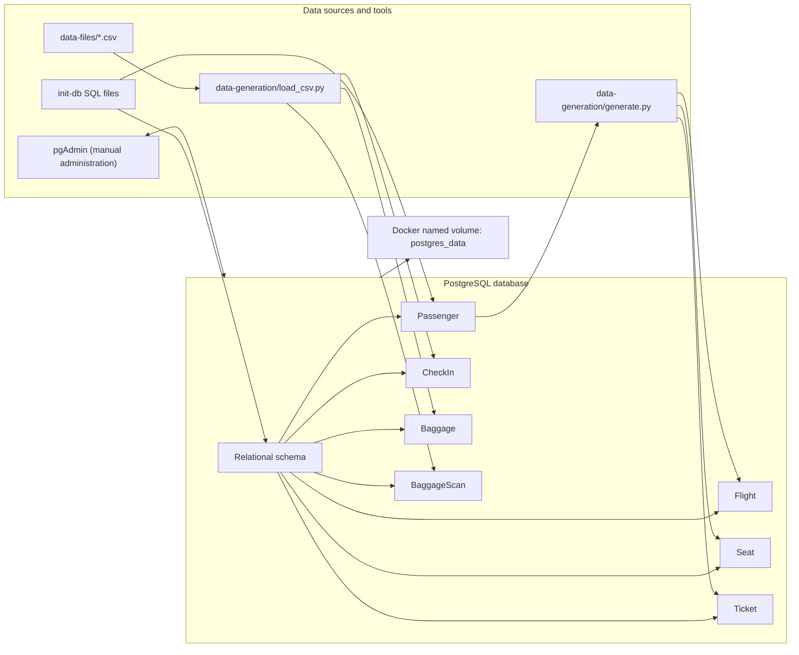
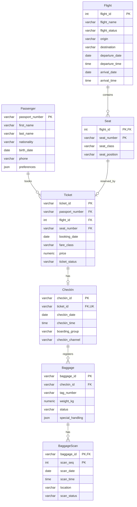

# Flight Reservation System

A PostgreSQL database project for a flight reservation workflow. It models passengers, flights, seats, tickets, check-in, baggage, and baggage scans. The repository contains the database definition, sample data, Python data-generation scripts, and CSV import scripts; it does not contain a customer-facing application or API.

## System structure and boundaries

| Component | Purpose |
| --- | --- |
| PostgreSQL | Stores the system's relational data and enforces keys, relationships, and checks. |
| Docker Compose | Starts PostgreSQL and pgAdmin and persists their data in named Docker volumes. |
| pgAdmin | Provides a browser-based interface for database administration and manual data operations. |
| `init-db/` | SQL files used to create the tables and initialize passenger data when the database is first created. |
| `data-generation/` | Python scripts that create flight, seat, and ticket records and load operational CSV files. |
| `data-files/` | Sample check-in, baggage, and baggage-scan CSV files. |

The database is the boundary of this project. Booking, check-in, and baggage operations are represented by stored records and scripts; no web UI, authentication layer, or service/API is included.

### Data Structure Diagram (DSD)

The diagram shows the main components and how data enters the database.



### Entity Relationship Diagram (ERD)



The schema is defined in [`init-db/01-create-tables.sql`](./init-db/01-create-tables.sql). Composite keys identify seats within a flight and scans within a bag. A ticket must reference a passenger and a seat; a seat can be assigned to at most one ticket. A ticket can have at most one check-in. Foreign keys and check constraints protect these relationships and values.

## Setup

1. Install Docker Desktop with Docker Compose. Python is only needed for the data-generation and CSV-import scripts.
2. Create and configure a local `.env` file with the variables expected by `docker-compose.yml` and the Python scripts: `DB_HOST`, `DB_PORT`, `DB_USER_SECRET`, `DB_PASSWORD_SECRET`, `DB_NAME_SECRET`, `PGADMIN_EMAIL`, and `PGADMIN_PASSWORD`. Keep the file private; do not commit its values.
3. From the repository root, start the services:

   ```console
   docker compose up -d
   ```

4. Open pgAdmin at `http://localhost:8080`. When registering the database server, use `db` as the host from inside the Compose network and `5432` as the port. Use the database credentials configured locally. When running Python scripts directly on your computer, configure `DB_HOST` to reach the published database port (typically `localhost`) and `DB_PORT` to `5432`.

The SQL scripts in `init-db/` are executed automatically when PostgreSQL initializes a new, empty data directory. They are not re-run automatically for an already-initialized database. The database and pgAdmin use the `postgres_data` and `pgadmin_data` Docker volumes declared in [`docker-compose.yml`](./docker-compose.yml).

## Data entry and loading

### 1. Database initialization with SQL

On the first start with an empty PostgreSQL volume, Docker runs the SQL files in `init-db/`. The schema is created by `01-create-tables.sql`, and `02-Passenger.sql` supplies passenger records. This prepares the tables and initial passenger data; it does not create all operational records.

### 2. Generate flights, seats, and tickets

`data-generation/generate.py` reads existing passengers and inserts sample flights, seats, and tickets. Run it from the repository root after the database has started and passenger data is present:

```console
python -m pip install psycopg2-binary python-dotenv
python data-generation\generate.py
```

The script uses the database connection variables from the local environment and reports an error if there are no passengers. It uses conflict handling for existing flight, seat, and ticket identifiers; review the generated records before re-running it.

### 3. Load check-in and baggage CSV files

The sample files in `data-files/` contain check-in, baggage, and baggage-scan rows. First ensure the referenced passengers, flights, seats, and tickets have been loaded; then install the import dependencies and run the loader from the repository root:

```console
python -m pip install pandas sqlalchemy psycopg2-binary python-dotenv
python data-generation\load_csv.py
```

The loader appends rows from `data-files/checkin_data.csv`, `data-files/baggage_data.csv`, and `data-files/baggage_scan_data.csv` to the `checkin`, `baggage`, and `baggagescan` tables. It loads check-ins before baggage and baggage before scans, so parent records must already exist. The import uses append mode and does not skip existing records; rerunning it against the same data can fail on primary-key or unique constraints.

For newly generated CSVs, `data-generation/generate_csv_files.py` reads existing tickets and their flights, then writes three CSV files to its current working directory. Place those files in `data-files/` before running the loader from the repository root.

### 4. Manual work in pgAdmin

pgAdmin can be used to inspect tables, run SQL statements, or import a CSV through a table's **Import/Export Data** action. Select CSV format, enable the header option for the provided files, and verify that the target table and column order match the CSV. Import parent rows before dependent rows. This is a manual alternative; the repository does not include a separate data-entry application.

### Data-entry screenshots

No screenshots are currently included in the repository. The diagrams above are rendered from Mermaid source and are not screenshots of pgAdmin or a running application. To provide visual evidence of the actual process, capture and add screenshots showing:

1. The initialized tables and passenger records in pgAdmin.
2. The CSV import settings and successful result for check-in/baggage data (or the Python loader output).

Suggested locations: `docs/images/data-entry-initialization.png` and `docs/images/data-entry-csv-import.png`.

## Backup and restore

The Compose setup persists database files in a Docker volume, but a volume is not an independent backup. This project does not configure automatic or scheduled backups. The recommended manual method is a PostgreSQL logical backup in pgAdmin's **Custom** format; it contains the database schema and data and can be restored separately from the Docker volume.

### Create a backup in pgAdmin

1. Connect to the server and right-click the flight-reservation database.
2. Choose **Backup...**.
3. Choose a filename ending in `.backup` and select **Custom** as the format.
4. Start the backup and confirm that pgAdmin reports successful completion.
5. Copy the resulting file to secure storage outside the database and pgAdmin Docker volumes. Keep more than one dated copy if the data is important.

### Restore a backup

Create or select an empty target database, right-click it, choose **Restore...**, select the `.backup` file, and start the restore. Check the restore messages and verify that the expected tables and records are present. Restore into a separate database first when you need to preserve the current database.

### Backup screenshots

No backup screenshots are currently included. Add screenshots of the pgAdmin backup settings (including the selected Custom format) and the successful completion message. Suggested locations: `docs/images/backup-settings.png` and `docs/images/backup-success.png`.

## Normalization and Functional Dependencies

This section analyzes every table in the schema defined in [`init-db/01-create-tables.sql`](./init-db/01-create-tables.sql). For each table it lists the functional dependencies (FDs), the candidate keys, the highest normal form satisfied, and the reasoning.

### Definitions and assumptions

- **Functional dependency (FD):** `X → Y` means that the value of `X` uniquely determines the value of `Y`.
- **Candidate key:** a minimal set of attributes that determines all other attributes of the table. The primary key is one of the candidate keys.
- **1NF:** all attribute values are atomic. The JSON columns (`Passenger.preferences` and `Baggage.special_handling`) are treated as single atomic values, because the system does not query or define dependencies on their internal contents. If searching by JSON content is needed in the future, they should be decomposed into separate tables.
- **2NF:** the table is in 1NF and no non-key attribute depends on only part of a candidate key.
- **3NF:** for every non-trivial FD `X → A`, either `X` is a superkey or `A` is part of a candidate key.
- **BCNF:** for every non-trivial FD `X → A`, `X` must be a superkey. BCNF is stricter than 3NF, so a table in BCNF is also in 3NF.

The FDs are derived from the keys and constraints actually defined in the SQL schema, together with the semantic assumptions stated under each table.

---

### 1. Passenger

**Candidate key:** `passport_number` (the only candidate key).

```text
passport_number → first_name, last_name, nationality, birth_date, phone, preferences
```

- The passport number determines all other passenger details.
- Name, nationality, birth date and phone do not determine one another and are not unique, so none of them is a key.
- **Normal form: BCNF.** The only determinant is the primary key.

### 2. Flight

**Candidate key:** `flight_id`.

```text
flight_id → flight_name, flight_status, origin, destination,
            departure_date, departure_time, arrival_date, arrival_time
```

- `flight_name` does not determine the other attributes, because the same flight name or number can operate on different dates, routes or times. It is therefore not a key.
- Arrival date and time are not derivable from the other attributes, because flight duration is not stored in the table.
- There are no dependencies between non-key attributes.
- **Normal form: BCNF.**

### 3. Seat

**Candidate key:** `(flight_id, seat_number)`.

```text
(flight_id, seat_number) → seat_class, seat_position
```

- `seat_class` and `seat_position` depend on the whole key, not on part of it. Each flight has its own seat map, so `seat_number` alone does not determine the class or position.
- There are no partial dependencies (2NF holds) and no transitive dependencies (3NF holds).
- **Normal form: BCNF.**
- *Assumption:* the seat map is defined per flight. If `seat_number → seat_position` held across all flights, there would be a partial dependency violating 2NF, and the table would need to be decomposed.

### 4. Ticket

**Candidate keys:**
- `ticket_id` (primary key)
- `(flight_id, seat_number)` (enforced by the `UNIQUE` constraint: a seat can be assigned to at most one ticket)

```text
ticket_id → passport_number, flight_id, seat_number,
            booking_date, fare_class, price, ticket_status

(flight_id, seat_number) → ticket_id, passport_number,
                           booking_date, fare_class, price, ticket_status
```

- Both determinants are superkeys, so no dependency violates BCNF.
- Passenger details are stored only in `Passenger`, and flight details only in `Flight`. The table holds only foreign keys to them, which avoids transitive dependencies such as `ticket_id → passport_number → first_name`.
- `fare_class` does not determine `price`, because the price varies by flight and booking date.
- **Normal form: BCNF.**

### 5. CheckIn

**Candidate keys:** `checkin_id` (primary key) and `ticket_id` (enforced by `UNIQUE`, modeling the 1:1 relationship with Ticket).

```text
checkin_id → ticket_id, checkin_date, checkin_time, boarding_group, checkin_channel
ticket_id  → checkin_id, checkin_date, checkin_time, boarding_group, checkin_channel
```

- Both determinants are superkeys.
- `boarding_group` and `checkin_channel` do not determine each other, and neither determines the check-in time.
- **Normal form: BCNF.**

### 6. Baggage

**Candidate key:** `baggage_id`.

```text
baggage_id → checkin_id, tag_number, weight_kg, status, special_handling
```

- `checkin_id` is a foreign key and does not determine the other attributes, because a single check-in can have several bags with different weights and statuses.
- `tag_number` may be unique in practice, in which case it would be an additional candidate key. Even then the table remains in BCNF. The current schema does not define a `UNIQUE` constraint on it.
- **Normal form: BCNF.**

### 7. BaggageScan

**Candidate key:** `(baggage_id, scan_seq)`.

```text
(baggage_id, scan_seq) → scan_date, scan_time, location, scan_status
```

- Each scan is identified by its bag and its sequence number within that bag.
- Bag details are not stored in this table, so there is no partial dependency on `baggage_id` alone.
- `location` and `scan_status` do not determine each other or the scan time.
- **Normal form: BCNF.**

---

### Summary

| Table | Candidate key(s) | Normal form |
| --- | --- | --- |
| Passenger | `passport_number` | BCNF |
| Flight | `flight_id` | BCNF |
| Seat | `(flight_id, seat_number)` | BCNF |
| Ticket | `ticket_id`, `(flight_id, seat_number)` | BCNF |
| CheckIn | `checkin_id`, `ticket_id` | BCNF |
| Baggage | `baggage_id` | BCNF |
| BaggageScan | `(baggage_id, scan_seq)` | BCNF |

**Conclusion:** All tables in the schema are in BCNF, and therefore also in 3NF. In every non-trivial functional dependency, the left-hand side is a superkey. Each piece of information (passenger, flight, seat, ticket, check-in, bag and scan details) is stored exactly once, and relationships between entities are expressed through foreign keys. As a result, there is no redundant data, and the schema is free of update, insertion and deletion anomalies.

## Repository layout

```text
.
├── data-files/
│   ├── baggage_data.csv
│   ├── baggage_scan_data.csv
│   └── checkin_data.csv
├── data-generation/
│   ├── generate.py
│   ├── generate_csv_files.py
│   └── load_csv.py
├── init-db/
│   ├── 01-create-tables.sql
│   ├── 02-Passenger.sql
│   └── 02-seed-data.sql
└── docker-compose.yml
```
