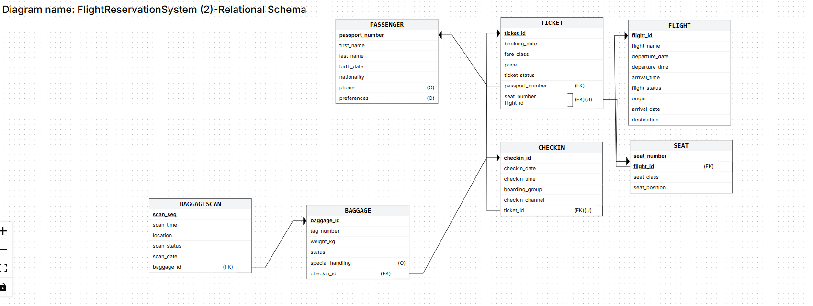
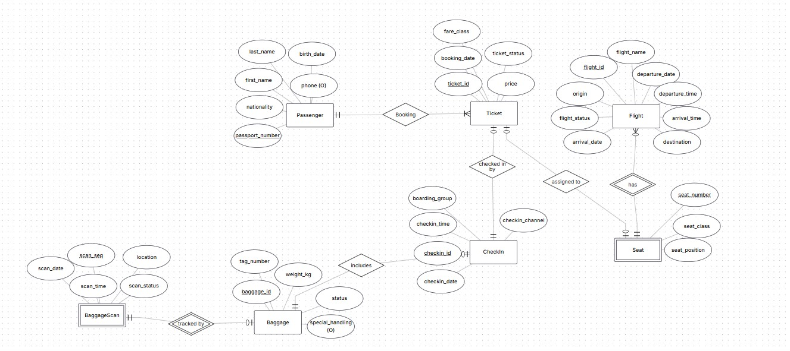
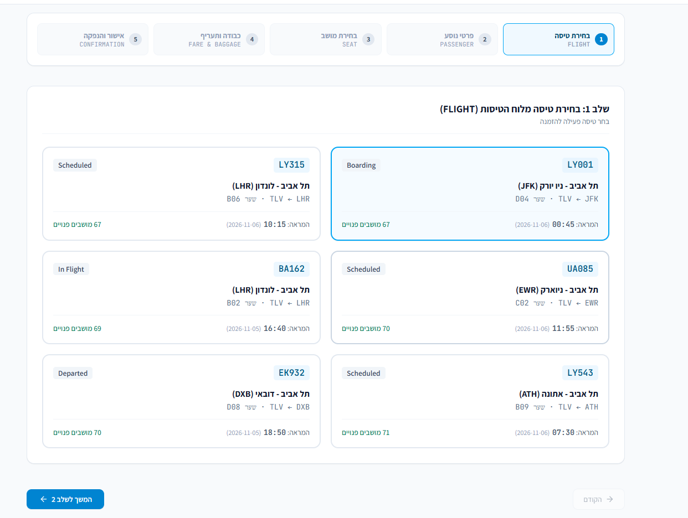
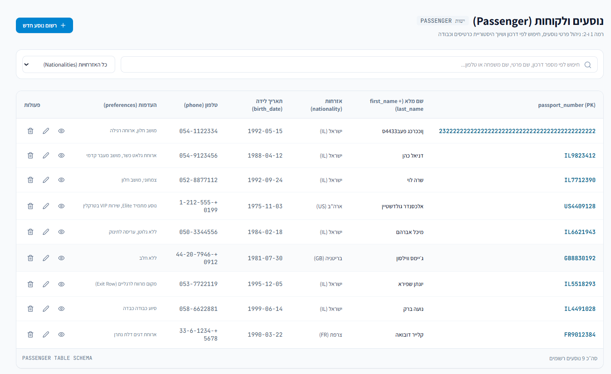

# Flight Reservation System

A PostgreSQL project for managing passengers, flights, seats, tickets, check-ins, baggage, and baggage scans. The repository includes a React frontend prototype, database scripts, and sample data. The frontend is a prototype and is not connected to a production backend.

## System structure

- **PostgreSQL** stores the data and enforces relationships.
- **Docker Compose** runs PostgreSQL and pgAdmin.
- **`init-db/`** creates the tables and inserts passenger data on the first database startup.
- **`data-generation/`** contains Python scripts for generating and loading data.
- **`data-files/`** contains sample CSV files.
- **`frontend/`** contains the user-interface prototype.

The database schema is defined in [`init-db/01-create-tables.sql`](./init-db/01-create-tables.sql). A passenger can have tickets; flights contain seats; tickets may have one check-in; check-ins can have baggage; and each bag can have multiple scans. The foreign keys and unique constraints enforce these relationships.

### Data Structure Diagram (DSD)



### Entity Relationship Diagram (ERD)



## Setup

1. Configure the required database and pgAdmin environment variables locally. Do not share passwords or commit secrets.
2. From the project root, start the services:

   ```console
   docker compose up -d
   ```

3. Open pgAdmin at `http://localhost:8080`. Register the database using the credentials configured for PostgreSQL.

The initialization SQL runs only when PostgreSQL starts with a new, empty data volume.

## Data population

The project uses SQL, Python, and CSV files to populate the database:

1. **SQL:** On first startup, `init-db/02-Passenger.sql` inserts 500 passengers.
2. **Python:** Run `python data-generation\generate.py` from the project root to generate flights, seats, and tickets for existing passengers.
3. **CSV:** Run `python data-generation\load_csv.py` from the project root to load check-in, baggage, and baggage-scan data from `data-files/`. Load parent records first. The loader appends rows, so do not import the same files twice.

The CSV files contain 500 check-ins, 500 baggage records, and 1,000 scans. Optional baggage-handling values include blanks, which are loaded as `NULL`. The Python script `generate_csv_files.py` can create new CSV files from existing tickets.

The screenshots below show the prototype and example records. They are not screenshots of the SQL or CSV import operations.





The assignment also asks for data from an external generator such as Mockaroo or GenerateData. An export from such a service is not currently included in this repository.

## Normalization

Each table is in BCNF: the determinants listed below are candidate keys or superkeys.

| Table | Functional dependency |
| --- | --- |
| Passenger | `passport_number` → passenger details |
| Flight | `flight_id` → flight details |
| Seat | `(flight_id, seat_number)` → seat class, position |
| Ticket | `ticket_id` and `(flight_id, seat_number)` → ticket details |
| CheckIn | `checkin_id` and `ticket_id` → check-in details |
| Baggage | `baggage_id` → baggage details |
| BaggageScan | `(baggage_id, scan_seq)` → scan details |

`Passenger.preferences` and `Baggage.special_handling` are treated as single JSON values.

## Backup and restore

PostgreSQL data persists in a Docker volume, but a volume is not a separate backup. The project includes a PostgreSQL custom-format backup at [`backup/flight_reservation.backup`](./backup/flight_reservation.backup). This format includes the database structure and data.

To create a backup in pgAdmin, right-click the database, select **Backup**, choose **Custom**, and save the file. To restore, create an empty database, select **Restore**, choose the backup file, and verify the restored tables and records.

The screenshot shows pgAdmin query results used to verify restored tables and record counts. It does not show the Restore dialog or completion message.


## Remaining submission items

- Add screenshots of the data-loading steps and the pgAdmin backup/restore operations.
- Add an external data-generator export if required for the chosen population method.
- Verify that the backup restores into a new empty database.
- Share the Git repository with `timaluhs` and add the required Git tag.
